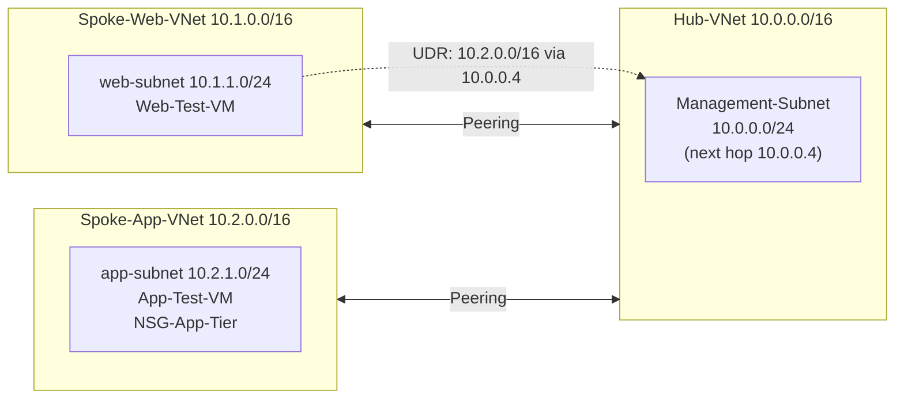

# Hub-and-Spoke Network Architecture on Azure

## 📌 Project Overview
In this project, I built a hub-and-spoke network in Microsoft Azure. The frontend (web) and backend (app) workloads sit in separate virtual networks (VNets), and both connect to a central Hub VNet through VNet peering. I then created a custom user-defined route (UDR) so that traffic from the web subnet to the app network is directed to a next hop in the Hub.

---

## 🏗️ Architecture

### Address plan

| VNet | Address space | Subnet | Range |
| :--- | :--- | :--- | :--- |
| `Hub-VNet` | `10.0.0.0/16` | `Management-Subnet` | `10.0.0.0/24` |
| `Spoke-Web-VNet` | `10.1.0.0/16` | `web-subnet` | `10.1.1.0/24` |
| `Spoke-App-VNet` | `10.2.0.0/16` | `app-subnet` | `10.2.1.0/24` |

---

## 🛠️ Components Deployed
*   **Resource Group:** `RG-NETWORKING-PROJECT` (Central India).
*   **Virtual Networks:** `Hub-VNet`, `Spoke-Web-VNet`, and `Spoke-App-VNet`, with non-overlapping address ranges.
*   **VNet Peering:** The Hub is peered with each spoke (`Hub-to-SpokeWeb` / `SpokeWeb-to-Hub` and `Hub-to-SpokeApp` / `SpokeApp-to-Hub`), with *Allow forwarded traffic* enabled on both sides. The two spokes are not peered with each other, so traffic between them must pass through the Hub.
*   **Test VMs:** `Web-Test-VM` in `web-subnet` and `App-Test-VM` in `app-subnet`, with no public IP addresses.
*   **Private DNS Zone:** An internal Azure Private DNS zone linked to both spoke VNets with auto-registration enabled, so the VMs can resolve each other by name instead of by IP address.
*   **Network Security Group:** `NSG-App-Tier`, associated with `app-subnet`.

---

## 🗂️ Custom Routing (Route Table and UDR)
1.  Created a route table named `Spoke-Transit-Route`.
2.  Added a user-defined route named `Force-Through-Hub-Router`:
    *   Destination: `10.2.0.0/16` (the whole App spoke)
    *   Next hop type: Virtual appliance
    *   Next hop IP address: `10.0.0.4` (in the Hub's `Management-Subnet`)
3.  Associated the route table with `web-subnet`, so traffic leaving the web subnet for the App spoke follows this route instead of the default one.

---

## ℹ️ Status
Built hands-on in the Azure portal using a free trial subscription.
